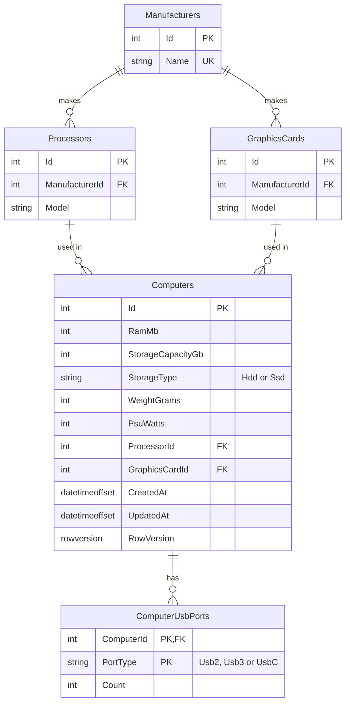

# Computer Inventory

A full-stack app for cataloguing computer hardware: browse, search, filter, view, add, edit and delete
computers, and add new processors and graphics cards along the way.

- **Backend:** .NET 10 Minimal APIs in a vertical slice architecture, EF Core 10, SQL Server Express, FluentValidation
- **Frontend:** React 19 + TypeScript (Vite), Redux Toolkit / RTK Query, MUI + MUI X Data Grid, React Hook Form + Zod
- **Infrastructure:** Docker Compose (SQL Server, API, nginx-served SPA)

## Quick start

Requires **Docker Desktop**. On Apple Silicon, enable *Settings → General → Use Rosetta for x86/amd64 emulation*
(the SQL Server image is amd64-only).

```bash
docker compose up --build
```

| What | URL |
|---|---|
| App | http://localhost:8080 |
| API docs (Scalar / OpenAPI) | http://localhost:5080/scalar |
| Health | http://localhost:5080/api/health/ready |

The first start creates the database and seeds 10 computers. `docker compose down` stops everything;
add `-v` to also delete the data.

## Features

- **Browse** computers in a grid with server-side paging and sorting.
- **Search and filter**: free-text search over processor and graphics card (every word must match),
  RAM and storage ranges, storage type, CPU/GPU manufacturer, USB port type and minimum PSU.
  Search, filters, sort and page live in the URL, so any view can be bookmarked or shared.
- **Details** in a side panel at `/computers/:id`: deep-linkable, and closing it returns to the same list.
- **Compare** 2–4 computers side by side: tick them in the list (the selection survives paging and filtering)
  and open `/compare?ids=…`, which is shareable. The best value of each spec is highlighted (more RAM, storage,
  power and ports; less weight; SSD over HDD), and a switch hides the specs that are the same for all.
- **Add, edit and delete** computers. Amounts are entered in friendly units (16 GB, 2 TB, 8.1 kg or 17.9 lb);
  errors are shown before submitting and, from the API, under the matching field.
- **Concurrent edits are detected**: saving over someone else's newer changes is refused, with an option
  to load the latest version.
- **Add a processor or graphics card from the computer form** when it isn't listed, including a new manufacturer.
- **kg / lb preference**, remembered across visits; **light / dark theme**.

## Local development

Prerequisites: .NET SDK 10, Node.js 24+, Docker.

```bash
docker compose up -d db                                  # just the database

dotnet run --project backend/src/ComputerInventory.Api   # http://localhost:5080 (docs at /scalar); migrates and seeds on start
cd frontend && npm install && npm run dev                # http://localhost:5173
```

Stop the `api` and `web` containers first if the full stack is running: they use the same ports.
To create a migration: `dotnet tool restore --tool-manifest backend/dotnet-tools.json`, then
`dotnet ef migrations add <Name> -p backend/src/ComputerInventory.Api -o Data/Migrations`.

## Tests

```bash
dotnet test backend/tests/ComputerInventory.Api.UnitTests          # fast, no dependencies
dotnet test backend/tests/ComputerInventory.Api.IntegrationTests   # real SQL Server via Testcontainers (needs Docker)
cd frontend && npm test                                            # Vitest + Testing Library + MSW
```

- **Unit tests** cover pure logic: validators, USB port syncing, constraint generation, paging maths.
- **Integration tests** run the real API (`WebApplicationFactory`) against a real SQL Server container, migrated
  and seeded like production. Queries, constraints, concurrency and migrations only prove themselves against the
  real database, so they're tested there rather than with mocks or an in-memory provider. Tests that change data
  create and remove their own records; one test fails if the EF model changes without a migration.
- **Frontend tests** render pages with the real store and router against a mocked API (MSW): user flows such as
  filtering, URL sync, editing with server errors and conflicts, adding and deleting.

## Architecture

### Backend: vertical slices

Code is organised by feature, not by technical layer. Each use case is one file holding its request,
validator, endpoint and handler, so a change to a feature usually touches one place.

```
backend/src/ComputerInventory.Api/
├── Features/
│   ├── Computers/      SearchComputers, GetComputer, CompareComputers, CreateComputer, UpdateComputer,
│   │                   DeleteComputer
│   │                   (+ ComputerSpec: rules shared by create and update)
│   ├── Processors/     ListProcessors, CreateProcessor
│   ├── GraphicsCards/  ListGraphicsCards, CreateGraphicsCard
│   ├── Components/     NewComponent: shared by the two "create" slices above
│   ├── Lookups/        GetLookups: manufacturers and enum values for filters
│   └── Health/         live and ready probes
├── Entities/           EF entities (plain data; rules live in validators and the database)
├── Data/               DbContext, entity configurations, migrations, seed data, audit interceptor
└── Common/             endpoint discovery, validation filter, paging, rate limiting, CORS
```

A slice looks like this (abridged):

```csharp
public static class GetComputer
{
    public sealed record Response(...);                       // what the endpoint returns

    public sealed class Endpoint : IEndpoint                  // discovered automatically
    {
        public void Map(IEndpointRouteBuilder app) => app.MapGet("/computers/{id:int}", Handle);
    }

    internal static async Task<Results<Ok<Response>, ProblemHttpResult>> Handle(int id, AppDbContext db, ...)
}
```

Handlers use `AppDbContext` directly: no repositories or mediator. EF already provides the unit of work
and query abstraction, and slices stay short enough to read top to bottom.

### Frontend

```
frontend/src/
├── api/            RTK Query base API, error helpers, failed-save notifications
├── app/            store and typed hooks
├── features/
│   ├── computers/  list page, grid, filters, details drawer, add/edit dialogs, form logic
│   ├── compare/    selection bar, comparison page, best-value rules
│   ├── components/ processor / graphics card picker and "add new" dialog
│   ├── lookups/    reference data for filters
│   └── preferences/ kg / lb preference
├── components/     shared UI (app shell, range slider, confirm dialog, ...)
└── utils/          unit formatting
```

**State:** server data is handled by **RTK Query** (caching, refetching after changes, cache updates from
save responses). Redux itself holds three small slices, each shared by several components: the list's
search/filter/sort/page state (filter bar, grid, URL), the computers picked for comparison (grid checkboxes,
selection bar, comparison page), and the kg/lb preference (grid, details, comparison), saved to `localStorage`
by a listener middleware. Everything else is local component state.

## Data model



**One canonical unit per measurement** (MB, decimal GB, grams, watts), so values can be compared, sorted and
range-filtered in SQL; the UI formats and converts. The seed data was normalized accordingly: weights given in
pounds converted to grams, sizes in TB/GB/MB converted to one unit each, product names cleaned of trademark
symbols and suffixes, and inconsistencies such as "SDD" or "R7360" corrected.

**Constraints in the database too**: positive values, valid enum values (generated from the C# enums, so they
can't drift apart), unique manufacturer names and unique models per manufacturer. The API validates first for
clear messages; the database is the backstop.

## Performance

The list endpoint was measured against **500,000 computers** (3,000 processors, 1,500 graphics cards,
1.2 million USB port rows), median of 5 warm requests through the API:

| Scenario | Before | After | Why |
|---|---|---|---|
| Search, common term ("gtx") | 1,027 ms | **17 ms** | Text matched on the small component tables, then computers found by id |
| Search, no matches | 3,037 ms | **7 ms** | Returns early: no computer queries at all |
| Search, two terms ("intel radeon") | 1,144 ms | **137 ms** | Same, one id filter per term |
| Sort by RAM | 301 ms | **36 ms** | Page of ids read from a `(RamMb, Id)` index, then details loaded for those ids |
| Sort by processor | 995 ms | **378 ms** | Ids-first paging (names live in another table, so the sort itself remains) |
| Filters + sort by PSU | 205 ms | **71 ms** | `(PsuWatts, Id)` index |
| Has USB-C | 144 ms | **85 ms** | Index on USB port type |
| First page, range filters, maker filter | 5–65 ms | unchanged | Already fast |

What changed, and why:

- **Search used `LIKE '%term%'` on every computer joined to its components**, for the count and again for the
  page. A leading wildcard can't use an index, so every search scanned the whole table. Now each term is
  matched against the processor and graphics card tables (a few thousand rows, ~5 ms), and computers are found
  through their foreign-key indexes. If a term matches no component, the API answers without querying computers.
- **Sorting a page sorted every column of every matching computer**, because EF puts the whole projection in the
  paged subquery. Now the page's ids are fetched with a narrow query, then their details are loaded.
- **Indexes on the sortable columns**, `(column, Id)`. Ties are broken by id *in the sort direction*, so one
  index serves ascending and descending. The cost was measured too: about +0.03 ms per insert and ~57 MB for
  500k computers, a good trade for a read-heavy catalogue. They were left out at first as speculative; the
  measurements are what justified adding them.

The rewritten queries are covered by the existing integration tests plus tests that compare search results with
a plain in-memory filter, check paging order in both directions, and search with more matching components than
SQL Server allows parameters.

## Design decisions and trade-offs

| Decision | Why | Trade-off / when I'd change it |
|---|---|---|
| **Lookup table for manufacturers, enums for storage and USB types** | Manufacturers are shared by CPUs and GPUs and can be added by users; storage and USB types are a fixed set the code depends on | A new USB type needs a code change and a migration (startup refuses to run with a forgotten migration) |
| **`int` identity keys** | Small, fast, ordered inserts; readable URLs | Guessable IDs: real protection is authorization (none here yet) and rate limiting; I'd add a separate public key if IDs had to be secret |
| **Optimistic concurrency with `rowversion`** | No locks held while someone edits; conflicts surface as 409 with a way to reload | The user re-applies their change after a conflict |
| **Timestamps set by an EF interceptor** | One place, testable with a fake clock | Writes that bypass the API wouldn't be stamped (SQL Server has no `ON UPDATE`; triggers would be the alternative) |
| **Indexes only where measurements showed a win** | Each index costs writes and space; sortable columns and the USB type filter earned theirs (see Performance) | Review index usage stats in production and drop unused ones |
| **Validation in three places** | Browser (instant feedback), API (authoritative, field-level messages), database (last line of defence) | Limits are duplicated in the frontend schema; an OpenAPI-generated client could share them |
| **SPA calls the API directly, with CORS** | Frontend and API deploy independently | Needs the allowed origins configured per environment |
| **Rate limiting per client IP** | Limits scraping and abuse | Behind a proxy, forwarded headers must be trusted for the real client IP |
| **Migrations on startup (configurable)** | Zero-step setup locally and in Docker | With several instances, run migrations as a separate deployment step |

## API

| Method | Path | Notes |
|---|---|---|
| GET | `/api/computers` | `search`, `minRamMb`/`maxRamMb`, `minStorageGb`/`maxStorageGb`, `storageType`, `processorManufacturerId`, `graphicsCardManufacturerId`, `usbPortType`, `minPsuWatts`, `sortBy`, `sortDir`, `page`, `pageSize` |
| GET | `/api/computers/{id}` | Includes `rowVersion` for updates |
| GET | `/api/computers/compare?ids=1&ids=5` | 2–4 computers' details in the requested order, plus ids that don't exist |
| POST | `/api/computers` | 201 with `Location` |
| PUT | `/api/computers/{id}` | Send the loaded `rowVersion`; 409 if it changed since |
| DELETE | `/api/computers/{id}` | 204, or 404 |
| GET / POST | `/api/processors`, `/api/graphics-cards` | POST takes `{ manufacturer, model }`; a new manufacturer name creates it |
| GET | `/api/lookups` | Manufacturers (with what they make), storage and USB port types |
| GET | `/api/health/live`, `/api/health/ready` | Process up / database reachable (503 otherwise) |

Errors use RFC 7807 problem details; validation errors list messages per field.

## Configuration

| Setting | Where | Default |
|---|---|---|
| `ConnectionStrings:Default` | API settings / env var | Local SQL Server container in Development |
| `Database:MigrateOnStartup` | API settings / env var | On, except in Production (on in Docker Compose) |
| `ApiDocs:Enabled` | API settings / env var | On in Development (on in Docker Compose) |
| `Cors:AllowedOrigins` | API settings / env var | `http://localhost:5173` in Development; none otherwise |
| `RateLimiting:PermitLimit` / `WindowSeconds` | API settings | 300 requests per 60 s per client IP |
| `VITE_API_BASE_URL` | `frontend/.env` (override in `.env.local`), Docker build arg | `http://localhost:5080/api` |
| `MSSQL_SA_PASSWORD` | environment / `.env` for Docker Compose | A local development password (see `docker-compose.yml`) |

## Known limitations and next steps

- **No authentication or authorization.** Next would be sign-in (e.g. OpenID Connect) and roles separating
  readers from editors.
- After the page loads, the URL follows the app state but not the other way round: editing the address by hand
  needs a reload.
- **CI** (build, lint, the three test suites) and **end-to-end tests** (Playwright against the Docker stack) would
  be the next additions to the test strategy.
- Possible features: side-by-side comparison of computers, a statistics dashboard, CSV export of search results.
